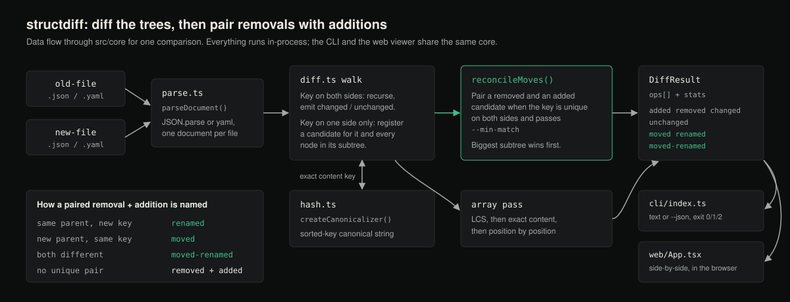

# structdiff

A semantic diff for JSON and YAML files. It parses both documents into trees
and diffs the trees, not the text, so a key that moved to a different
parent, or was renamed but kept the same value, shows up as `moved` /
`renamed` instead of a `-`/`+` pair that makes you read the whole value again
to notice it never actually changed.



Two ways to use it: a CLI for CI (`structdiff a.yaml b.yaml`, exit code
driven by `--fail-on`; its only runtime dependency is the `yaml` parser), and
a side-by-side visual diff that runs entirely in the browser.

## Status

Version 0.1.0. The CLI, the library API and the web viewer work and are
tested; CI runs the test suite on Ubuntu, Windows and macOS with Node 20 and
22, plus typecheck, lint, coverage thresholds, both builds, and an exact-output
check of the bundled example. It is not published to npm. Only JSON and YAML
are parsed: TOML, INI, `.env` and HCL are not supported.

## Why not a text or JSON diff

Line-based diff (`diff`, `git diff`, most "JSON diff" npm packages) compares
*text*. Reorder two keys in a YAML file, or rename `retryLimit` to
`maxRetries`, and a text diff shows the whole surrounding block as changed
(textually, it did change) even though nothing about the configuration's
*meaning* changed. You end up scanning walls of red/green to
find the one real edit.

Most "structural" JSON diff tools (jsondiffpatch, deep-diff, and the dozens
of clones of both) fix the reordering problem, since objects are compared by
key rather than by line, but they still treat a rename or a move as a delete
plus an insert. Nothing pairs them back up.

structdiff does the pairing. It computes a canonical, key-order-independent
form of every value on either side that has no counterpart, and when a key
disappears from one place and an equal-content key appears somewhere else,
it reports that as one `moved` / `renamed` / `moved-renamed` operation
instead of two unrelated ones. It does the same for array elements: an
item that changed position, or a whole array that got reversed, is reported
as `moved`, not as an added/removed pair at every shifted index. That
pairing is what makes a reviewed Kubernetes manifest, a Terraform
`.tfvars.json` export, or an app config after a refactor readable.

## How it works

1. **Parse** both documents (YAML is a JSON superset, so both formats share
   one code path in `src/core/parse.ts`). Files ending in `.json` are read
   with `JSON.parse`; every other extension is read as YAML.
2. **Walk both trees together** (`src/core/diff.ts`): keys present at the
   same path in both are compared recursively; primitives that differ are
   `changed`; a key present in only one document becomes a **candidate**
   (with its full subtree, recursively) rather than an immediate op.
3. **Key every candidate** by its exact canonical form, a sorted-key JSON
   string (`createCanonicalizer` in `src/core/hash.ts`; not a lossy hash, so
   equal keys always mean equal values). A removed candidate and an added
   candidate with the same key, where that key is *unique* on both sides,
   are the same value that moved.
4. **Classify the pairing** by comparing the old and new parent path and
   key: same parent + different key = `renamed`; different parent + same
   key = `moved`; both different = `moved-renamed`.
5. **Prefer the biggest match.** Candidates are matched biggest-subtree
   first, so a whole renamed block (e.g. `database:` → `datastore:` with
   identical children) is reported once, not once per leaf inside it. But
   if only *part* of a container moved out, the container is *not* dumped
   as one misleading "removed" blob; its remaining, unexplained pieces are
   reported individually instead.
6. **Arrays** get their own pass: a longest-common-subsequence match finds
   elements that kept their relative order (any index shift there is a pure
   `moved`); an exact-content pass then catches values that survived but
   fell fully out of order (e.g. a reversed array, which defeats any
   single LCS alignment); whatever's left is diffed position-by-position so
   a one-field change inside an array element is a targeted `changed`, not
   a whole-element replacement.

### A known, deliberate limitation

The move/rename matcher only pairs values that are "distinctive enough".
Strings and numbers need at least `--min-match` characters (default 5);
booleans, `null`, `{}` and `[]` are never paired; non-empty objects and
arrays always qualify. Without that floor, two unrelated `true`s or two `1`s
anywhere in the document would get matched as a "move", a false positive
that would be worse than no match at all. So a renamed boolean field is
always reported as remove+add, and a renamed short string or number is too
unless you lower `--min-match`. Raise it for stricter pairing.

## Install

This project is **not published to npm**. The `structdiff` package on the
npm registry is an unrelated project by another author, so do not run
`npm install -g structdiff` or `npx structdiff` expecting this tool.
Install from a clone instead:

```sh
git clone https://github.com/hellpuffyt/structdiff
cd structdiff
npm ci && npm run build
npm link        # puts `structdiff` on your PATH (or: node dist/cli/index.js)
```

Requires Node.js 20 or newer.

## CLI usage

Real output, run against the fixtures checked into [`examples/`](examples):

```console
$ structdiff examples/before.yaml examples/after.yaml --no-color
+ added database.maxConnections = 50
~ changed database.poolSize: 10 -> 20
→ moved featureFlags[2] -> featureFlags[0]
→ moved featureFlags[0] -> featureFlags[2]
+ added featureFlags[3] = "betaSearch"
→ moved+renamed network.retryLimit -> http.maxRetries
→ moved network.timeoutSeconds -> http.timeoutSeconds
→ renamed logging.format -> logging.layout
- removed tags.owner (was "payments-team")

2 added, 1 removed, 1 changed, 3 moved, 1 renamed, 1 moved+renamed, 6 unchanged
$ echo $?
1
```

`network.retryLimit` became `http.maxRetries` (a different parent *and* a
different key, same value), and it's reported as one `moved+renamed`
operation. `network.timeoutSeconds` moved to `http.timeoutSeconds` (same
key, different parent) as `moved`. `logging.format` became `logging.layout`
(same parent, different key) as `renamed`. None of those three show up as
a remove and an add.

Exit codes: `0` no differences at or above the `--fail-on` level, `1`
differences found (by default any `changed`, `added` or `removed` value;
moves and renames alone exit 0), `2` usage, read or parse errors, including
input too deeply nested to diff, so a failure can never be mistaken for a
clean diff. See `--fail-on` for CI gating.

```
$ structdiff --help
structdiff 0.1.0
Semantic diff for JSON/YAML/config files: detects moved and renamed keys
instead of line noise.

Usage:
  structdiff <old-file> <new-file> [options]

Options:
  --json                Print the raw diff result as JSON.
  --fail-on <level>     Exit 1 if any op of this severity or higher exists.
                         Levels (low to high): moved, changed, removed.
                         Default: changed.
  --min-match <n>       Minimum content length for move/rename pairing
                         (default: 5).
  --no-color            Disable ANSI colors in text output.
  -h, --help            Show this help.
  -v, --version         Show the version number.
```

### CI gating

`--help` lists three levels, but `--fail-on` accepts any op type. The
severity order is `unchanged` < `moved` = `renamed` = `moved-renamed` <
`changed` = `added` < `removed`.

```sh
# Fail the build only when something was actually removed
# (moves, renames, and additions are allowed to pass silently):
structdiff prod.tfvars.json staged.tfvars.json --fail-on removed

# Fail on anything but pure reordering/renaming:
structdiff before.yaml after.yaml --fail-on changed
```

### JSON output

`--json` prints the full `DiffResult` (see [`src/core/types.ts`](src/core/types.ts))
for scripting: every op with its old/new path and value, plus a `stats`
summary. Real excerpt from the same example (abridged: the real output prints
each path array one element per line):

```console
$ structdiff examples/before.yaml examples/after.yaml --json
{
  "ops": [
    {
      "type": "unchanged",
      "oldPath": ["database", "host"],
      "newPath": ["database", "host"],
      "oldValue": "db.internal.example.com",
      "newValue": "db.internal.example.com"
    },
    {
      "type": "added",
      "newPath": ["database", "maxConnections"],
      "newValue": 50
    },
    {
      "type": "changed",
      "oldPath": ["database", "poolSize"],
      "newPath": ["database", "poolSize"],
      "oldValue": 10,
      "newValue": 20
    },
    ...
```

### How equality and parsing are decided

Values are compared by an exact canonical form (sorted keys, JSON-quoted
strings), never by a hash, so two different values can never be reported
as `unchanged`. YAML is parsed with the `yaml` package without resolving
YAML 1.1 type tags: `!!timestamp`, `!!binary`, `!!set` and `!!omap` stay in
their plain JSON-compatible form (string, string, mapping, sequence), unknown
tags such as `!!js/function` become plain strings, and alias expansion is
capped by the parser (alias bombs are rejected). Multi-document YAML files
are rejected with a parse error.

For very large arrays the order-preserving LCS pass runs only on the part
between the common prefix and suffix, and is skipped above 4 million table
cells; every element is still matched by exact content, so the op counts
stay correct, but which of several *duplicate* values is reported as moved
may differ from a full LCS.

## Visual diff (web)

```sh
npm install
npm run dev:web     # Vite dev server, http://localhost:5173/ by default
```

This starts a local side-by-side viewer: paste or upload a Before/After
document (JSON or YAML), and it renders both trees with each line colored by
what happened to it (added, removed, changed, moved, renamed, or
moved+renamed), with a stats bar summarizing the whole diff. It runs
entirely client-side (nothing is uploaded) and follows the system light/dark
preference. `npm run build:web` produces a static `dist-web/` bundle with
relative asset paths that you can host anywhere. The Vite dev server is for
local use only.

## Library usage

The package is not on npm; install it from a built clone
(`npm install /path/to/structdiff` after `npm run build` there). The core
exports `diffValues`, `parseDocument`, `formatFromFilename`, `formatPath`,
`ParseError` and the types in `src/core/types.ts`.

```ts
import { diffValues, parseDocument, formatFromFilename } from "structdiff";

const oldVal = parseDocument(oldSource, formatFromFilename("before.yaml"));
const newVal = parseDocument(newSource, formatFromFilename("after.yaml"));
const result = diffValues(oldVal, newVal, { minMatchLength: 5 });

for (const op of result.ops) {
  if (op.type !== "unchanged") console.log(op.type, op.oldPath, op.newPath);
}
```

## Development

```sh
npm ci
npm test              # vitest: 81 tests in 6 files, deterministic, no network
npm run coverage      # thresholds in vitest.config.ts: 90% lines, 85% branches
npm run typecheck     # tsc --noEmit, both the core/cli and web tsconfigs
npm run lint          # eslint, zero warnings allowed
npm run build         # compiles src/core + src/cli to dist/
npm run build:web     # builds the web viewer to dist-web/
```

See [CONTRIBUTING.md](CONTRIBUTING.md) for more.

## Security

structdiff only parses the two documents you give it; nothing in them is
executed. See "How equality and parsing are decided" above for the parser
settings. Please report vulnerabilities privately as described in
[SECURITY.md](SECURITY.md).

## License

MIT, copyright 2026 Prabesh Sharma. See [LICENSE](LICENSE).
